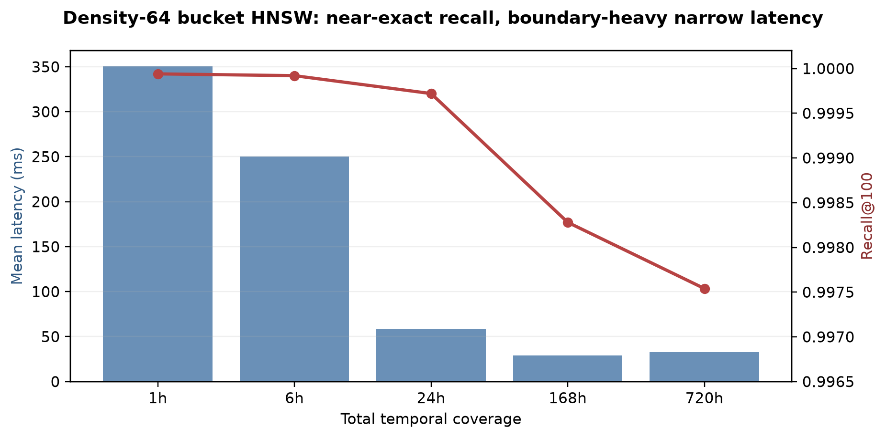
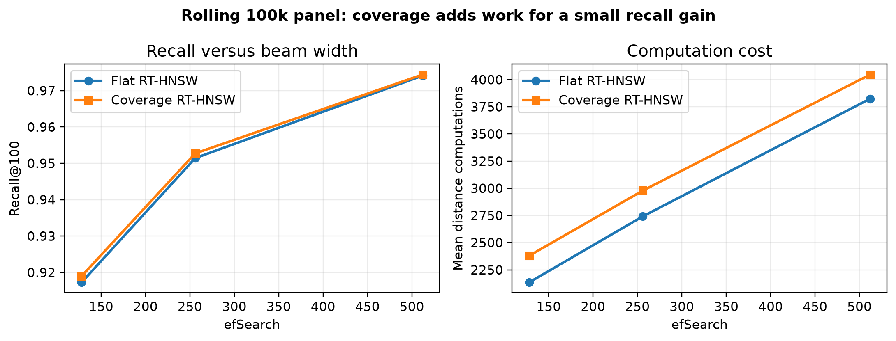
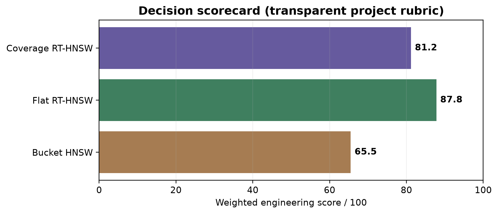
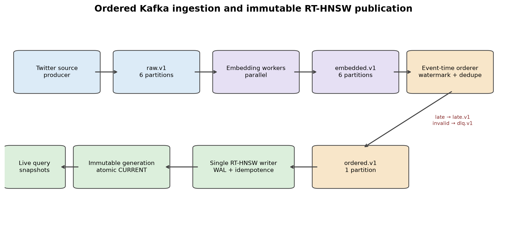

# Executive summary

This report evaluates three temporal-filtered approximate-nearest-neighbor
architectures for the query:

> Return the top-$k$ vectors nearest to query vector $q$, subject to each
> result timestamp belonging to one or more half-open intervals $[a,b)$.

The evaluated designs are:

1. **Density-balanced bucket HNSW** — 64 independent FAISS HNSW indexes,
   partitioned by temporal population and routed before vector search.
2. **Flat multi-scale RT-HNSW** — one chronologically constructed graph with
   semantic edges, protected temporal connectivity, independent 24/168/720-hour
   range edges, strict traversal, and exact fallback.
3. **Coverage-aware RT-HNSW** — the flat graph plus conservative block min/max
   metadata, diverse representatives, and a mandatory block-coverage phase.

The principal findings are:

- **Bucket HNSW is the highest-recall design.** On the 990,000-vector panel it
  achieved **0.9991 Recall@100**, but required **144.18 ms mean** and
  **566.15 ms p95 latency**. Narrow ranges and fragmented predicates are
  expensive because partially covered boundary buckets require substantial
  overfetch.
- **Flat RT-HNSW is the best tested single-graph trade-off.** On the separate
  100,000-vector rolling panel at `efSearch=256`, it achieved approximately
  **0.9514–0.9515 Recall@100**, **2,742 distance computations**, and
  **33.9–36.3 ms p95 latency**. Exact fallback gives perfect recall for small
  eligible sets, while broad-range recall remains the main quality limitation.
- **Coverage-aware RT-HNSW is more deterministic, but not more efficient.** It
  covered every intersecting temporal block and raised same-`efSearch` recall
  from **0.95143 to 0.95273**, but increased distance computations by
  **8.65%**. At matched computation, recall fell to **0.94317**. It should
  remain an optional diagnostic or tail-risk mode rather than replace flat
  RT-HNSW.
- **The recommended online design is flat RT-HNSW behind an ordered Kafka
  pipeline.** Event-time reordering, a single canonical ordered partition,
  idempotent micro-batches, append WALs, immutable generations, and atomic
  snapshot publication preserve chronological graph invariants while allowing
  live queries.

## Final recommendation

Use a query planner rather than forcing all predicates through one path:

```text
eligible population <= 5,000
    -> exact timestamp pre-filter + exact vector scan

broad predicate requiring near-exact recall
    -> density-balanced bucket HNSW

moderate/broad predicate with a tunable latency-quality target
    -> flat multi-scale RT-HNSW

rare query requiring deterministic regional participation
    -> coverage-aware RT-HNSW mode
```

For the third architecture, retain **flat multi-scale RT-HNSW** as the default.
Use coverage only conditionally when an entry-concentration or missed-region
predictor indicates risk.

# 1. Scope and comparability

## 1.1 Critical comparability warning

The bucket and RT-HNSW results were produced on different evaluation panels.
Their absolute latency, recall, computation, and storage values must not be
presented as a direct controlled head-to-head comparison.

### Panel A — full Twitter bucket evaluation

| Property | Value |
|---|---|
| Database | 990,000 DLT-Tweets vectors |
| Queries | 9,600 balanced filtered queries |
| Vector dimension | 384 normalized MiniLM dimensions |
| Requested neighbors | $k=100$ |
| Temporal coverage | 1, 6, 24, 168, 720 hours |
| Fragmentation | 1–4 OR predicates |
| Ground truth | Exact timestamp pre-filter followed by exact squared L2 |
| Evaluated method | Density-balanced bucket HNSW |

### Panel B — rolling graph evaluation

| Property | Value |
|---|---|
| Database | Earliest 100,000 DLT-Tweets vectors |
| Queries | 900 matched filtered queries |
| Vector dimension | 384 normalized MiniLM dimensions |
| Requested neighbors | $k=100$ |
| Temporal coverage | 1, 6, 24, 168, 720 hours |
| Fragmentation | 1, 2, 4 intervals |
| Exact fallback | At most 5,000 eligible vectors |
| Evaluated methods | Flat and coverage-aware RT-HNSW |

Direct quantitative comparison is valid between flat and coverage-aware
RT-HNSW because they share the same graph, query set, ground truth, and search
configuration. Bucket metrics are reported as a separate full-data panel.

## 1.2 Query semantics

Each query consists of:

- vector $q \in \mathbb{R}^{384}$;
- requested result count $k=100$; and
- one or more timestamp intervals.

Intervals are normalized into a sorted, disjoint union. Eligibility is strict
and half-open:

$$
eligible(v) \iff \exists [a_i,b_i): a_i \le t(v) < b_i.
$$

Squared Euclidean distance is used:

$$
d(q,v)=\sum_{j=1}^{384}(q_j-v_j)^2.
$$

## 1.3 Evaluation metrics

| Metric | Interpretation |
|---|---|
| Recall@100 | Fraction of exact eligible top-100 IDs returned |
| Complete-result rate | Fraction returning `min(k, eligible_count)` results |
| Mean/p50/p95 latency | End-to-end query latency distribution |
| Distance computations | Number of query-vector-to-database-vector evaluations |
| Candidates examined | ANN candidates retrieved before final filtering/reranking |
| Edges examined | Graph adjacency entries inspected during traversal |
| Ground-truth block coverage | Fraction of blocks containing exact top-k results that traversal visited |
| Build time | Wall-clock index construction time |
| Storage | Persisted index artifacts, with vector-inclusion caveats stated |

A complete-result rate below one does not always indicate failure: some narrow
queries contain fewer than 100 eligible vectors. The bucket panel's theoretical
maximum was 0.9329 because 644 queries had fewer than 100 eligible records.

## 1.4 Latency caveat

FAISS bucket traversal is native code, while RT-HNSW traversal is primarily
Python. Memory-map warming, variant execution order, and Python heap overhead
can materially affect absolute latency. Deterministic counters and recall are
therefore more reliable for small differences. A publication-quality final
comparison requires one dataset, workload, implementation language, hardware
configuration, cache protocol, and storage accounting model.

# 2. Architecture I — density-balanced bucket HNSW

## 2.1 Design objective

Bucket HNSW moves temporal filtering before ANN search by partitioning the
timeline. Instead of asking one global graph for candidates and filtering them
afterward, the query routes only to indexes whose temporal domains intersect
the predicate.

Density balancing assigns approximately equal vector populations to buckets.
This is preferable to fixed-duration buckets for Twitter data because tweet
volume is bursty: a fixed week can contain far more vectors than another week.

## 2.2 Index construction

The evaluated configuration is:

| Parameter | Value |
|---|---:|
| Partition strategy | Density balanced |
| Buckets | 64 |
| HNSW `M` | 32 |
| `efConstruction` | 200 |
| `efSearch` | 128 |
| Boundary overfetch | 2 |
| Boundary safety factor | 1.25 |

Construction steps:

1. Sort database rows by timestamp while preserving stable source IDs.
2. Choose bucket boundaries that avoid splitting equal timestamps.
3. Assign every row to exactly one temporal bucket.
4. Build one FAISS `IndexHNSWFlat` per bucket.
5. Persist a local-to-global ID map and timestamp metadata per bucket.
6. Persist a manifest describing boundaries, population, model, and HNSW
   configuration.

## 2.3 Search mechanism

```text
query intervals
    ↓
normalize and merge interval union
    ↓
locate every intersecting bucket
    ↓
fully covered bucket ───────→ ordinary HNSW search
partially covered bucket ───→ overfetch + exact timestamp filtering
    ↓
merge candidates from all buckets
    ↓
deduplicate global IDs
    ↓
exact squared-L2 rerank
    ↓
return timestamp-valid top-k
```

### Fully covered buckets

Every vector in a fully covered bucket is temporally eligible. The system can
accept ordinary HNSW candidates without per-candidate timestamp rejection.

### Partial boundary buckets

A partial bucket contains both eligible and ineligible rows. The planner
estimates the eligible fraction and requests additional candidates. Every
candidate then receives an authoritative timestamp check.

### Disjoint predicates

The bucket union is computed across all normalized components. A physical
bucket is searched at most once, even if multiple intervals intersect it.
Results are globally deduplicated and reranked.

### Conceptual pseudocode

```python
def bucket_search(query, intervals, k):
    intervals = normalize_union(intervals)
    routes = route_to_intersecting_buckets(intervals)
    candidates = []

    for bucket, overlap in routes:
        if overlap.fully_covers(bucket):
            candidates += bucket.hnsw.search(query, local_budget(bucket))
        else:
            raw = bucket.hnsw.search(
                query,
                boundary_overfetch_budget(bucket, overlap),
            )
            candidates += [
                item for item in raw
                if timestamp_in_union(item.timestamp, intervals)
            ]

    return exact_rerank(deduplicate(candidates), query, k)
```

## 2.4 Complexity model

If a query selects $r$ buckets and retrieves $c_i$ candidates from bucket $i$,
a useful operational model is:

$$
T \approx T_{route}+\sum_{i=1}^{r}T_{HNSW,i}(c_i)+O\left(\sum_i c_i\right)
$$

for filtering, deduplication, and reranking. Fragmentation increases $r$ and the
number of partial boundaries. Narrow queries can be expensive when their
eligible fraction inside a large population-balanced bucket is very small.

## 2.5 Full-data results

| Metric | Result |
|---|---:|
| Recall@100 | **0.99908** |
| Mean latency | 144.18 ms |
| p50 latency | 44.43 ms |
| p95 latency | 566.15 ms |
| Mean candidates examined | 18,708 |
| Mean valid candidates | 827.66 |
| Mean distance computations | 35,811 |
| Mean buckets selected | 3.89 |
| Mean partial buckets | 3.26 |
| Complete-result rate | 0.9329 |
| Build time | 52.67 s |
| HNSW storage | 1.790 GB |
| ID-map plus timestamp storage | 15.9 MB |

{width=90%}

### Results by temporal coverage

| Coverage | Recall@100 | Mean latency | p95 latency | Distance computations |
|---:|---:|---:|---:|---:|
| 1 hour | 0.99994 | 350.43 ms | 581.88 ms | 38,166 |
| 6 hours | 0.99992 | 250.23 ms | 579.02 ms | 37,850 |
| 24 hours | 0.99972 | 58.27 ms | 203.59 ms | 33,894 |
| 168 hours | 0.99828 | 29.00 ms | 150.92 ms | 28,941 |
| 720 hours | 0.99754 | 32.95 ms | 154.01 ms | 40,206 |

Narrow ranges are slower, not faster, because most selected buckets are partial
and boundary compensation must retrieve enough candidates to produce eligible
survivors.

### Results by predicate fragmentation

| OR components | Recall@100 | Mean latency | p95 latency | Distance computations |
|---:|---:|---:|---:|---:|
| 1 | 0.99831 | 42.58 ms | 146.67 ms | 16,168 |
| 2 | 0.99907 | 106.22 ms | 291.50 ms | 29,718 |
| 3 | 0.99939 | 176.29 ms | 437.99 ms | 42,674 |
| 4 | 0.99955 | 251.61 ms | 586.92 ms | 54,685 |

Quality remains high, but query fanout and boundary work grow sharply.

## 2.6 Strengths

- Highest measured recall among the three designs.
- Mature, optimized FAISS HNSW inside every partition.
- Temporal routing precedes vector search.
- Fully covered buckets require no timestamp filtering.
- Buckets can be searched concurrently.
- Old partitions can be sealed, replaced, expired, or rebuilt independently.
- Late records can be directed to a recent mutable or delta bucket.

## 2.7 Weaknesses

- Boundary overfetch dominates selective predicates.
- Fragmented intervals create multi-index fanout.
- Candidate allocation and global merging are operationally complex.
- Sixty-four HNSW indexes require lifecycle and memory management.
- Storage includes duplicated per-index structure and embedded FAISS vectors.
- The architecture is less natural for one globally ordered rolling graph.

## 2.8 Project-level novel features

The project contribution is not the general idea of temporal partitioning.
The implemented combination includes:

- density-balanced boundaries that preserve duplicate timestamp groups;
- safe half-open routing and interval-union deduplication;
- separate behavior for fully and partially covered buckets;
- boundary-safety overfetch;
- global exact reranking across bucket-local ID spaces; and
- an adaptive path capable of selecting exact, bucket, or global search.

These are project-level implementation contributions, not universal literature
priority claims.

# 3. Architecture II — flat multi-scale RT-HNSW

## 3.1 Design objective

Flat RT-HNSW retains one global graph but makes temporal eligibility part of
construction, entry selection, and traversal. It avoids maintaining one HNSW
per time partition.

```text
chronologically ordered insertion
    ↓
semantic edges + protected temporal backbone
    + independent multi-scale range edges
    ↓
query-aware in-range entry points
    ↓
strict filtered beam search
```

FAISS HNSW is used only during construction as an online semantic candidate
generator. Query traversal uses custom persisted adjacency.

## 3.2 Chronological construction invariant

Vectors are inserted in stable order:

$$
(timestamp\_ms, stable\ source\ vector\ ID).
$$

Local IDs therefore form a nondecreasing timestamp sequence. A timestamp range
can be translated into a contiguous local-ID interval using binary search.
This property is fundamental to strict routing, range edges, exact fallback,
and streaming continuation.

## 3.3 Graph topology

| Edge class | Nominal per-node budget |
|---|---:|
| Semantic neighbors | 20 |
| 24-hour range, left/right | 2 + 2 |
| 168-hour range, left/right | 2 + 2 |
| 720-hour range, left/right | 2 + 2 |
| Nominal semantic plus range degree | 32 |
| Protected predecessor/successor | Separate |

### Semantic edges

For each insertion, FAISS HNSW searches previously inserted vectors and
proposes semantic candidates. Bounded reciprocal adjacency retains nearby
vectors under the semantic degree budget.

### Protected temporal backbone

Every node links to its chronological predecessor and successor. These links
are stored separately and cannot be evicted by semantic pruning. Consequently,
every contiguous temporal interval retains a basic internal path.

### Independent multi-scale range edges

Each 24-, 168-, and 720-hour scale receives its own left and right budget.
Candidate pools combine:

- semantic construction candidates;
- evenly sampled vectors inside the scale window; and
- immediate chronological neighbors.

A co-eligibility score favors candidates that are both semantically close and
likely to survive the temporal scale:

$$
score(u,v)=\frac{d(u,v)}{coeligibility(u,v)+\epsilon}.
$$

Independent budgets prevent one scale from consuming all range-aware capacity.

### Periodic gateways

Periodic nodes provide in-range starting candidates. Gateway placement and
upper-hierarchy experiments were tested under equal budgets, but did not
materially improve quality. The recommended topology remains flat.

## 3.4 Search mechanism

### Step 1 — normalize and count eligibility

Intervals are normalized and translated into local-ID components by binary
search over the ordered timestamp array.

### Step 2 — exact fallback

If the total eligible population is at most 5,000, perform exact squared-L2
search over only those vectors. This is both accurate and efficient for narrow
ranges.

### Step 3 — select strict in-range entries

Sample periodic gateways whose timestamps lie inside the component, score them
against the query, and retain the best entry seeds.

### Step 4 — strict beam traversal

For each expanded node, inspect enabled semantic, range, gateway, and temporal
edges. A destination is rejected before vector access when its local ID lies
outside the current component.

```python
for neighbor in adjacency(current):
    if neighbor < component_left or neighbor >= component_right:
        continue                 # no vector read and no distance computation
    if neighbor in visited:
        continue
    distance = squared_l2(query, vector[neighbor])
    update_candidate_and_result_heaps(neighbor, distance)
```

### Step 5 — component merge

Disjoint components are searched independently. Candidate IDs are deduplicated
and exactly reranked before returning the global top-$k$.

### Conceptual complete algorithm

```python
def flat_rt_hnsw_search(query, intervals, k, ef):
    components = timestamp_components(normalize_union(intervals))
    eligible_count = sum(size(c) for c in components)

    if eligible_count <= 5000:
        return exact_search(query, all_eligible_ids(components), k)

    candidates = []
    for component in components:
        if size(component) <= 5000:
            candidates += exact_search(query, ids(component), k)
            continue

        seeds = select_in_range_gateways(query, component)
        candidates += strict_beam_search(
            query,
            component,
            seeds,
            semantic_edges=True,
            temporal_edges=True,
            multiscale_range_edges=True,
            ef=ef,
        )

    return exact_rerank(deduplicate(candidates), query, k)
```

## 3.5 Complexity model

For $m$ eligible vectors and bounded graph degree $M$, exact fallback costs:

$$
O(md).
$$

For graph search expanding $E$ nodes, an operational model is:

$$
O(E M d + E\log ef),
$$

plus component routing and final reranking. This is not a worst-case
logarithmic guarantee; graph exploration can approach the eligible population
in an adverse case.

## 3.6 Rolling-panel results

### Recall and computation sweep

| efSearch | Recall@100 | Mean latency | p95 latency | Distance computations |
|---:|---:|---:|---:|---:|
| 128 | 0.9173 | 4.65 ms | 18.02 ms | 2,134 |
| 256 | 0.9515 | 7.57 ms | 33.86 ms | 2,742 |
| 512 | 0.9741 | 12.96 ms | 61.82 ms | 3,825 |
| 1,024 | 0.9875 | 22.83 ms | 114.56 ms | 5,630 |
| 2,048 | 0.9946 | 41.44 ms | 211.75 ms | 8,352 |

The controlled flat-versus-coverage run measured flat recall as 0.95143 at
ef256, consistent with the established 0.9515 result. Its latency was
12.64 ms mean and 36.25 ms p95 in that run; the difference from the earlier
7.57 ms mean illustrates cache and run-order sensitivity.

### Broad-query quality

| Coverage | ef128 | ef256 | ef512 | ef1024 | ef2048 |
|---:|---:|---:|---:|---:|---:|
| 168 hours | — | 0.8699 | 0.9316 | 0.9694 | 0.9872 |
| 720 hours | — | 0.8873 | 0.9391 | 0.9681 | 0.9860 |

The 1-, 6-, and 24-hour slices generally take the exact path and achieve recall
1.0. Overall recall therefore combines exact narrow queries with approximate
broad queries.

### Fragmentation at ef256

| Components | Recall@100 | Mean latency | Distance computations |
|---:|---:|---:|---:|
| 1 | 0.9416 | 4.40 ms | 1,563 |
| 2 | 0.9452 | 7.55 ms | 2,147 |
| 4 | 0.9675 | 10.76 ms | 4,516 |

Each component receives an independent search budget, so work grows roughly
additively. Recall can rise because fragmented queries receive multiple beams.

### Construction and storage

| Metric | Result |
|---|---:|
| Build time | 133.1 s |
| Custom graph storage | Approximately 15.6 MB |
| Periodic gateways | 195 |
| Vectors included in storage number | No |

## 3.7 Strengths

- One logical graph rather than 64 separate ANN indexes.
- Strict temporal filtering before distance computation.
- Perfect narrow-range recall through exact fallback.
- Continuous recall/cost control through `efSearch`.
- Compact custom graph storage.
- Natural chronological incremental construction.
- No boundary-bucket overfetch.
- Strong basis for Kafka replay and immutable live snapshots.

## 3.8 Weaknesses

- Broad-range recall remains below bucket HNSW at practical beams.
- Python traversal limits throughput and absolute latency.
- No demonstrated logarithmic scaling for the flat custom graph.
- Significantly late events cannot be inserted into chronological local-ID order
  without rebuild, repair, or a delta index.
- Periodic gateway and upper-hierarchy alternatives produced negligible gains.
- The controlled RT evaluation currently covers 100,000, not 990,000 vectors.

## 3.9 Project-level novel features

The implemented combination contributes:

1. **Protected chronological connectivity** outside replaceable semantic lists.
2. **Independent 24/168/720-hour range budgets.**
3. **Temporal co-eligibility edge scoring.**
4. **Strict pre-distance destination rejection.**
5. **Query-aware in-range entry selection.**
6. **Hybrid exact/graph query execution.**
7. **Chronological online construction using only prior records.**
8. **Differentially tested durable incremental continuation through Kafka.**

The novelty claim applies to the project's integrated design and evaluation,
not to universal priority over all filtered-ANN literature.

# 4. Architecture III — coverage-aware RT-HNSW

## 4.1 Motivation

Ordinary beam search prioritizes semantic distance. For a broad temporal range,
a small set of attractive entries may dominate and some temporal regions may
receive no exploration. Coverage-aware RT-HNSW tests whether missed temporal
regions explain flat RT-HNSW's broad-range recall loss.

The graph topology remains unchanged. A compact temporal directory and a
mandatory scheduling phase are added to query execution.

## 4.2 Coverage metadata

Timestamp-ordered local IDs are divided into fixed-population blocks. The
default block size is 512, producing approximately 196 blocks for 100,000
vectors.

Every block stores:

- left and right local-ID offsets;
- minimum and maximum observed timestamp;
- first temporal member;
- last temporal member;
- sampled approximate medoid; and
- a sampled farthest-point representative.

The default four-representative metadata is approximately 8 KB at 100,000
vectors, excluding NumPy headers.

Min/max metadata describes precise blocks, not everything transitively
reachable through an HNSW node. This avoids unhelpfully broad metadata in a
cyclic graph.

## 4.3 Formal invariants

### Complete partition

Every vector belongs to exactly one block and block offsets cover $[0,N)$
without gaps or overlaps.

### Conservative temporal bounds

For every $v$ in block $B_i$:

$$
L_i \le t(v) \le R_i.
$$

Bounds may create false-positive block work but may not exclude an eligible
member.

### Safe block pruning

A block is pruned only when:

$$
R_i < queryStart \quad \lor \quad L_i \ge queryEnd.
$$

### Mandatory coverage

Let $B_Q$ be blocks intersecting a graph-searched component and $E_Q$ be blocks
with at least one mandatory expansion. Search enforces:

$$
E_Q=B_Q.
$$

This is a block-coverage guarantee. It does **not** guarantee examination of
every eligible vector or exact nearest-neighbor recall.

## 4.4 Search mechanism

Coverage and ANN quality use separate phases:

```text
normalized query component
    ↓
discover every intersecting temporal block
    ↓
score block representatives
    ↓
mandatory block-local coverage queue
    ↓
merge all scored frontiers
    ↓
ordinary global strict ANN beam
    ↓
exact candidate rerank
```

### Mandatory phase

For every intersecting block:

1. Filter stored representatives to the exact query component.
2. Add component boundary IDs when a block is only partially intersected.
3. Score up to four representatives.
4. Select the closest representative as the block seed.
5. Expand at least one block-local candidate.
6. Reject any destination outside the strict query component before vector
   access.
7. Defer cross-block navigation to the subsequent global beam.

Ordinary beam termination cannot terminate this phase.

### ANN phase

Coverage frontiers are merged into the normal candidate heap. The usual strict
multi-scale search then spends the configured `efSearch` capacity on the most
promising nodes.

### Conceptual pseudocode

```python
def coverage_rt_hnsw_search(query, component, ef, expansions=1):
    blocks = directory.intersecting(component)
    global_frontier = []

    for block in blocks:
        reps = strict_component_representatives(block, component)
        seed = min(reps, key=lambda v: squared_l2(query, v))
        frontier = block_local_expand(
            query, seed, component, block, minimum=expansions
        )
        global_frontier.extend(frontier)

    assert every(block.was_expanded for block in blocks)
    return strict_global_beam(query, component, global_frontier, ef)
```

## 4.5 Controlled comparison at ef256

| Metric | Flat RT-HNSW | Coverage-aware | Change |
|---|---:|---:|---:|
| Recall@100 | 0.95143 | 0.95273 | +0.00130 |
| Graph-query recall | 0.87511 | 0.87846 | +0.00334 |
| Mean distance computations | 2,741.9 | 2,979.0 | +8.65% |
| Mean nodes visited | 2,733.4 | 2,868.6 | +4.95% |
| Semantic edges examined | 3,914.0 | 4,623.9 | +18.14% |
| Range edges examined | 2,125.7 | 2,517.4 | +18.43% |
| Ground-truth block coverage | 0.99924 | 1.00000 | +0.00076 |
| Coverage-invariant failures | N/A | 0 | — |

The paired all-query recall improvement had an approximate 95% bootstrap
interval of `[+0.00070,+0.00201]`. It is measurable but small.

{width=95%}

## 4.6 Equal-computation result

Equal budget is the decisive acceptance test.

| Configuration | Mean distance computations | Recall@100 |
|---|---:|---:|
| Flat RT-HNSW, ef256 | 2,741.9 | **0.95143** |
| Coverage, ef205, four representatives | 2,746.8 | 0.94317 |
| Coverage, ef238, one representative | 2,747.9 | 0.94933 |

At matched computation, four-representative coverage loses 0.00827 recall. The
cheaper one-representative form still loses 0.00210. Coverage therefore fails
the equal-budget promotion gate.

## 4.7 Stability across beam widths

| efSearch | Flat recall | Coverage recall | Recall gain | Flat computations | Coverage computations |
|---:|---:|---:|---:|---:|---:|
| 128 | 0.91726 | 0.91898 | +0.00172 | 2,134.5 | 2,379.1 |
| 256 | 0.95143 | 0.95273 | +0.00130 | 2,741.9 | 2,979.0 |
| 512 | 0.97410 | 0.97440 | +0.00030 | 3,823.8 | 4,046.1 |

Coverage becomes less useful as the ordinary beam becomes stronger.

## 4.8 Broad-query results

| Coverage | Flat recall | Coverage recall | Gain | Flat computations | Coverage computations |
|---:|---:|---:|---:|---:|---:|
| 168 hours | 0.86989 | 0.87278 | +0.00289 | 5,536.5 | 5,696.0 |
| 720 hours | 0.88728 | 0.89089 | +0.00361 | 4,799.9 | 5,825.8 |

The 720-hour cell pays approximately 21.4% more distance computations for a
0.361 percentage-point recall increase.

## 4.9 Per-query stability

Among 900 queries at ef256:

- 75 improved;
- 801 tied;
- 24 regressed;
- best change was +0.20 recall; and
- worst change was -0.04 recall.

Among the 350 graph-routed queries:

| Statistic | Flat | Coverage-aware |
|---|---:|---:|
| Mean recall | 0.87511 | 0.87846 |
| Standard deviation | 0.10545 | 0.10182 |
| 5th percentile | 0.6845 | 0.6900 |
| 10th percentile | 0.7400 | 0.7400 |
| Median | 0.9000 | 0.9000 |

The distribution is slightly tighter, but per-query improvement is not
monotonic.

## 4.10 Why the gain is small

Flat RT-HNSW already visited nearly every temporal block containing an exact
top-100 result:

| Diagnostic | Result |
|---|---:|
| Overall ground-truth block coverage | 99.924% |
| Graph-query ground-truth block coverage | 99.805% |
| Graph queries missing any ground-truth block | 3 of 350 |

Coverage improved all three missed-region cases:

| Workload ID | Width | Components | Flat block coverage | Flat recall | Coverage recall |
|---:|---:|---:|---:|---:|---:|
| 81 | 168 h | 1 | 0.53125 | 0.15 | 0.21 |
| 214 | 720 h | 4 | 0.82090 | 0.58 | 0.63 |
| 664 | 720 h | 2 | 0.96364 | 0.78 | 0.79 |

The mechanism correctly solves missed-region failures, but such failures are
rare. Most remaining errors occur inside blocks that flat traversal already
visits.

## 4.11 Parameter sensitivity

### Block size

| Block size | Recall@100 | Mean computations | Mean blocks considered |
|---:|---:|---:|---:|
| 256 | 0.95387 | 3,208.8 | 73.82 |
| 512 | 0.95273 | 2,979.0 | 37.28 |
| 1,000 | 0.95203 | 2,861.7 | 19.45 |
| 2,048 | 0.95172 | 2,800.0 | 9.88 |

Smaller blocks give slightly better recall but rapidly increase mandatory work.

### Representatives scored per block

| Representatives | Recall@100 | Mean computations |
|---:|---:|---:|
| 1 | 0.95196 | 2,828.8 |
| 2 | 0.95249 | 2,877.4 |
| 4 | 0.95273 | 2,979.0 |

### Mandatory expansions per block

| Expansions | Recall@100 | Mean computations | Coverage computations |
|---:|---:|---:|---:|
| 1 | 0.95273 | 2,979.0 | 303.1 |
| 2 | 0.95342 | 3,078.7 | 429.5 |
| 5 | 0.95553 | 3,369.9 | 798.3 |

Additional work raises recall, but does not establish better efficiency.

## 4.12 Strengths

- Formal and directly testable block-coverage invariant.
- Deterministic regional participation.
- Tiny block metadata overhead.
- Preserves strict filtering and the original graph topology.
- Identifies whether failures arise from missed regions or within-region search.
- Slightly improves lower-tail recall and reduces recall variance.

## 4.13 Weaknesses

- Fails equal-computation comparison.
- Adds work proportional to intersecting block count.
- Can regress individual queries.
- Becomes expensive for full-range queries at larger $N$.
- At 990,000 vectors and block size 512, a full range spans roughly 1,934
  blocks and can require up to 7,736 representative evaluations before the
  ordinary beam.
- Coverage metadata is compatible with streaming insertion but is not yet
  integrated into the Kafka writer branch.

## 4.14 Project-level novel features

The project-specific extension adds:

1. conservative fixed-population temporal block metadata;
2. boundary, medoid, and farthest-point block representatives;
3. a mandatory coverage phase independent of ANN termination;
4. strict block-local expansion before a global semantic beam;
5. explicit block-coverage and ground-truth-block diagnostics; and
6. an equal-computation acceptance gate demonstrating when the mechanism should
   not replace the simpler design.

# 5. Comparative analysis

## 5.1 Architectural comparison

| Property | Bucket HNSW | Flat RT-HNSW | Coverage-aware RT-HNSW |
|---|---|---|---|
| Logical ANN graphs | 64 | 1 | 1 |
| Temporal routing before ANN | Bucket directory | In-range entries | Block directory + entries |
| Temporal structure in topology | Partition boundaries | Backbone + range edges | Same flat graph |
| Strict rejection before distance | Partial buckets only | Yes | Yes |
| Exact fallback | Planner-dependent | Yes | Yes |
| Multi-interval handling | Bucket union + merge | Component searches | Component + block searches |
| Temporal coverage guarantee | Partition routing | No explicit block guarantee | Yes, intersecting blocks |
| Recall control | Bucket budget/overfetch | `efSearch` | Coverage budget + `efSearch` |
| Update unit | Bucket/index | Vector/micro-batch | Vector/micro-batch + metadata |
| Main failure mode | Boundary/fanout cost | Broad-range recall | Extra mandatory work |

## 5.2 Quantitative panels

### Panel A — bucket HNSW on 990k vectors

| Recall | Mean latency | p95 latency | Distance computations | Build time |
|---:|---:|---:|---:|---:|
| 0.99908 | 144.18 ms | 566.15 ms | 35,811 | 52.67 s |

### Panel B — controlled RT-HNSW comparison on 100k vectors

| Method | Recall | Distance computations | Ground-truth block coverage |
|---|---:|---:|---:|
| Flat RT-HNSW ef256 | 0.95143 | 2,741.9 | 0.99924 |
| Coverage-aware ef256 | 0.95273 | 2,979.0 | 1.00000 |
| Coverage-aware equal-compute | 0.94317 | 2,746.8 | 1.00000 |

The panels answer different questions. Bucket HNSW demonstrates near-exact
quality at full scale but high and variable cost. RT-HNSW demonstrates the
single-graph trade-off and supports controlled topology experiments.

## 5.3 Query search comparison

### Narrow query

- **Bucket:** likely intersects one or two partial buckets and may overfetch many
  ineligible vectors.
- **Flat RT-HNSW:** counts eligible rows and executes exact search below 5,000.
- **Coverage RT-HNSW:** also executes exact search; coverage adds nothing.

### Broad contiguous query

- **Bucket:** searches several buckets; many can be fully covered, producing
  near-exact quality.
- **Flat RT-HNSW:** performs one strict beam over a large eligible subgraph.
- **Coverage RT-HNSW:** first forces one expansion in every intersecting block,
  then runs the same beam.

### Fragmented query

- **Bucket:** forms a union of intersecting buckets and pays for multiple partial
  boundaries.
- **Flat RT-HNSW:** searches each interval component independently and merges.
- **Coverage RT-HNSW:** discovers and covers blocks within every independently
  searched component before merging.

## 5.4 Engineering scorecard

The following is a transparent project decision rubric, not an empirical metric
and not a substitute for the two-panel comparability warning.

| Criterion | Weight | Bucket HNSW /10 | Flat RT-HNSW /10 | Coverage RT-HNSW /10 |
|---|---:|---:|---:|---:|
| Filter correctness | 20% | 10.0 | 10.0 | 10.0 |
| Recall/quality | 20% | 10.0 | 8.5 | 8.6 |
| Query efficiency | 15% | 4.0 | 8.5 | 7.0 |
| Cost/latency predictability | 10% | 3.0 | 8.0 | 6.0 |
| Online-update readiness | 15% | 5.0 | 9.0 | 8.0 |
| Operational simplicity | 10% | 5.0 | 7.5 | 6.5 |
| Storage efficiency | 10% | 4.0 | 9.0 | 9.0 |
| **Weighted score** | **100%** | **65.5** | **87.8** | **81.2** |

{width=80%}

### Score interpretation

- Bucket HNSW wins pure recall but loses on cost variance and multi-index
  operations.
- Flat RT-HNSW earns the highest overall engineering score because it combines
  strict correctness, compact storage, tunable quality, and an implemented
  streaming continuation architecture.
- Coverage-aware RT-HNSW improves a formal property but loses efficiency and
  operational simplicity. It is valuable as an optional mode, not the default.

# 6. Kafka streaming and online-update design

## 6.1 Purpose

Offline chronological construction demonstrates the insertion algorithm, but a
live system must also handle:

- out-of-order source arrival;
- parallel embedding;
- duplicate and conflicting events;
- writer crashes and replay;
- immutable query consistency;
- late data; and
- publication without exposing partial graph state.

The implemented Kafka continuation targets flat multi-scale RT-HNSW. Coverage
metadata can later be updated when a block is active and finalized when sealed,
but mandatory coverage is not currently part of the streaming branch.

{width=96%}

## 6.2 Topic architecture

| Topic | Partitions | Key | Retention | Purpose |
|---|---:|---|---|---|
| `twitter.raw.v1` | 6 | `tweet_id` | 7 days | Validated source records |
| `twitter.embedded.v1` | 6 | `tweet_id` | 7 days | Parallel embedding output |
| `twitter.index.ordered.v1` | 1 | `index_sequence` | Indefinite | Canonical reconstruction log |
| `twitter.index.late.v1` | 3 | `tweet_id` | 30 days | Events behind committed watermark |
| `twitter.index.dlq.v1` | 3 | `tweet_id` | 30 days | Invalid or conflicting events |
| `twitter.orderer.state.v1` | 1 | State key | Compacted | Watermark, buffer, and dedupe changelog |
| `twitter.index.checkpoints.v1` | 1 | `index_name` | Compacted | Published generation checkpoint |

The ordered topic must not be compacted. It is the authoritative replay log.
Producers use `acks=all`, idempotence, and preferably Zstandard compression.

## 6.3 Why an explicit ordering stage is required

Kafka preserves order only within a partition and only in arrival order.
RT-HNSW requires event-time order:

$$
local\_id\ order = nondecreasing\ timestamp\ order.
$$

The orderer consumes all embedded partitions and maintains a persistent heap
ordered by:

```text
(event_time_ms, tweet_id)
```

For active partition $p$, let $maxEventTime_p$ be its latest observed event
time. The safe watermark is:

$$
watermark=\min_p(maxEventTime_p)-allowedLateness.
$$

Events at or below the safe watermark can be emitted deterministically. Idle
partitions must be excluded after an idle timeout or one quiet partition can
stall the watermark indefinitely.

For exact historical replay equivalence, the tie key should match the offline
builder, preferably `(event_time_ms, source_vector_id)`, or both builders must
adopt the same tweet-ID tie rule.

## 6.4 Event validation and idempotence

An ordered index event contains:

```text
schema_version
index_name
index_sequence
tweet_id
event_time_ms
ingest_time_ms
embedding_model
embedding_dimension
embedding
source_event_id
content_sha256
```

The writer enforces:

- contiguous `index_sequence`;
- nondecreasing event-time ordering key;
- finite 384-dimensional `float32` vectors;
- stable embedding model and normalization policy;
- exact duplicate acceptance only when the content hash matches; and
- rejection of sequence gaps or conflicting duplicate content.

Kafka transactions provide exactly-once processing inside Kafka. The external
filesystem index uses idempotence, WAL recovery, and sequence/hash verification
at the Kafka/filesystem boundary.

## 6.5 Incremental graph update

A single active writer owns one index. For each ordered micro-batch it:

1. assigns chronological local IDs;
2. inserts vectors into the persisted FAISS construction-candidate index;
3. adds bounded reciprocal semantic edges;
4. extends protected predecessor/successor links;
5. updates independent 24/168/720-hour range edges;
6. updates periodic gateway state;
7. persists vectors, timestamps, adjacency, construction state, and checkpoint;
8. publishes a complete immutable generation; and
9. commits the Kafka offset only after publication.

Micro-batches of 256–1,024 events or approximately one second are suitable for
correctness testing. Full-generation rewrites are not suitable for long-term
990k-scale operation; append-only chunks or copy-on-write pages are required.

## 6.6 Durable commit protocol

For batch `[first_sequence,last_sequence]`:

1. Poll records without committing offsets.
2. Validate order, sequence, dimensions, and content hashes.
3. Write the complete batch to an append WAL.
4. Flush and `fsync` the WAL.
5. Construct generation $N+1$ in a staging directory.
6. Persist adjacency, vectors, timestamps, FAISS construction state, and
   checksums.
7. Write a generation manifest with sequence and topic offsets.
8. `fsync` files and directory entries.
9. Atomically replace the `CURRENT` pointer.
10. Publish the compacted checkpoint.
11. Commit the ordered-topic consumer offset.
12. Remove obsolete WAL entries.

### Crash recovery

| Failure point | Recovery behavior |
|---|---|
| Before WAL flush | Kafka redelivers the batch |
| After WAL, before publication | Recover/discard staging generation and replay |
| After publication, before offset commit | Redelivery is verified and skipped idempotently |
| After offset commit | Durable generation already contains the batch |

## 6.7 Immutable live query snapshots

Query services use read-copy-update semantics:

1. Resolve `CURRENT` and open one immutable generation.
2. Pin that generation for the complete query.
3. Writer atomically publishes a newer generation.
4. New queries switch to the new generation.
5. Existing queries complete on the old generation.
6. Old generations are collected only after reader leases expire.

Search responses identify the serving generation and last index sequence. A
client may request `min_sequence` and wait up to a bounded freshness timeout.

## 6.8 Late-arrival policy

Appending a timestamp older than the committed watermark would violate ordered
local IDs. Such records are never silently inserted into the main graph.

Initial policy:

```text
event_time above watermark  -> canonical ordered log
event_time behind watermark -> twitter.index.late.v1
```

Future options are:

1. scheduled complete rebuild;
2. a small late-event delta index merged at query time; or
3. bounded repair inside an unsealed recent segment.

## 6.9 Development setup

The Kafka implementation exists on the `RT-HNSW-kafka-ingestion` lineage.
Start the local broker and initialize topics:

```bash
docker compose -f deploy/kafka/docker-compose.yml up -d
./deploy/kafka/create-topics.sh
```

Install Kafka dependencies:

```bash
pip install -e '.[kafka]'
```

Run components in separate terminals:

```bash
kafka-twitter-embedder --index-name twitter-rt-hnsw

kafka-twitter-orderer \
  --index-name twitter-rt-hnsw \
  --allowed-lateness-ms 600000

kafka-twitter-index-writer \
  --index-name twitter-rt-hnsw \
  --index Twitter_data/ann/streaming_rt_hnsw

serve-twitter-rt-hnsw \
  --index Twitter_data/ann/streaming_rt_hnsw \
  --port 8080

kafka-twitter-producer --input new_tweets.jsonl
```

Example strict live query:

```bash
curl -X POST http://127.0.0.1:8080/search \
  -H 'Content-Type: application/json' \
  -d '{
    "query": [...384 floats...],
    "intervals": [[START_MS, END_MS]],
    "k": 100,
    "ef_search": 256,
    "min_sequence": 1000,
    "wait_timeout_ms": 2000
  }'
```

Operational endpoints:

```text
GET  /health
GET  /status
POST /refresh
POST /search
```

## 6.10 Streaming implementation status

Implemented and unit/differential tested:

- validated producer and deterministic development embedder;
- transactional event-time orderer;
- duplicate/conflict detection;
- late and dead-letter routing;
- contiguous sequence allocation;
- compacted state changelog;
- durable incremental flat RT-HNSW writer;
- persisted FAISS construction state;
- append WAL and orphan recovery;
- immutable checksummed generations;
- atomic `CURRENT` publication;
- idempotent replay;
- live snapshot reload and per-query pinning;
- cross-process reader leases; and
- freshness waits and safe generation collection.

Outstanding before production:

- broker-level kill/restart failure injection;
- multi-broker replication and minimum-ISR configuration;
- production embedding rather than the development stub;
- append-only chunk or copy-on-write adjacency persistence;
- automatic generation compaction and retention;
- late-event delta/rebuild policy;
- authentication, authorization, quotas, and rate limiting;
- 250k, 500k, and 990k streaming scale tests; and
- coverage-metadata continuation if coverage mode is retained.

Docker-based broker tests were previously blocked because the local Docker
daemon was unavailable. Unit and deterministic differential tests do not
replace broker-level failure testing.

## 6.11 Required observability

### Ingestion and ordering

- accepted, duplicate, invalid, and late records;
- embedding latency and failure count;
- per-partition consumer lag;
- watermark and reorder-buffer age;
- idle partition count;
- source-to-index event-time latency.

### Writer

- consumed and published sequence;
- sequence gaps and content conflicts;
- micro-batch p50/p95/p99 append latency;
- WAL size and recovery count;
- generation bytes and publication time;
- FAISS candidate and reciprocal-edge update time;
- Kafka lag in records and event-time seconds.

### Query service

- generation and sequence served;
- exact-versus-graph routing rate;
- snapshot reload latency;
- query p50/p95/p99 during publication;
- freshness-wait timeout rate; and
- fixed-corpus recall regression.

# 7. Final design decision

## 7.1 Bucket HNSW

Choose bucket HNSW when near-exact broad-range recall is the primary objective
and higher, variable query cost is acceptable. Add an exact-path planner for
narrow ranges to avoid boundary overfetch.

## 7.2 Flat RT-HNSW

Choose flat multi-scale RT-HNSW as the default single-graph temporal ANN design.
It provides strict correctness, compact storage, a useful beam-width trade-off,
and the best alignment with ordered Kafka updates.

Recommended query configuration:

```text
semantic degree                 20
range degree per side/scale      2
range scales                    24, 168, 720 hours
protected temporal links         2
exact threshold               5,000
initial efSearch                256
```

Raise `efSearch` for workloads requiring higher broad-range recall. Move strict
traversal into fused C++/pybind11 before drawing production latency conclusions.

## 7.3 Coverage-aware RT-HNSW

Do not enable mandatory all-block coverage by default. It provides a strong
correctness invariant but does not improve equal-budget recall.

Retain it for:

- missed-region diagnostics;
- temporal fairness requirements;
- rare tail-risk queries;
- workload characterization; and
- a future selective trigger.

A selective trigger could activate coverage only when:

- all initial seeds lie in a narrow part of a broad interval;
- seed-vector distances are weak or unusually similar;
- previous query telemetry predicts missed-region risk; or
- a service-level contract explicitly requires regional participation.

# 8. Limitations and future work

1. **Unify evaluation panels.** Run bucket, flat, and coverage methods on the
   same 990,000-vector database and identical workload.
2. **Use one optimized traversal implementation.** Python-versus-FAISS latency
   is not a fair systems comparison.
3. **Scale flat RT-HNSW.** Evaluate 250k, 500k, and 990k graph quality and build
   behavior.
4. **Implement fused strict traversal.** Move heap operations, edge loops, and
   pre-distance interval checks to C++.
5. **Replace complete-generation rewrites.** Use append-only vector chunks and
   copy-on-write adjacency pages.
6. **Add late-event delta indexes.** Merge a small recent/late index at query
   time and compact periodically.
7. **Test rolling expiration.** Retire old data while preserving local-ID and
   snapshot semantics.
8. **Run Kafka failure injection.** Kill the orderer and writer at every commit
   point under a real broker.
9. **Evaluate a selective coverage trigger.** Compare against the mandatory
   policy under equal computation.
10. **Standardize storage accounting.** Separate vectors, graph, mappings,
    metadata, construction state, WAL, and retained generations.

# 9. Conclusion

Density-balanced bucket HNSW, flat RT-HNSW, and coverage-aware RT-HNSW represent
three distinct strategies:

```text
Bucket HNSW:
partition time first, then search multiple conventional graphs

Flat RT-HNSW:
build one graph whose connectivity and traversal understand time

Coverage-aware RT-HNSW:
add deterministic temporal-region participation before semantic search
```

Bucket HNSW provides the best recall but incurs severe boundary and
fragmentation costs. Flat multi-scale RT-HNSW provides the strongest current
single-graph architecture and integrates naturally with ordered streaming.
Coverage-aware RT-HNSW successfully guarantees block participation and repairs
a small number of missed-region failures, but its same-budget inefficiency
prevents promotion to the default design.

The recommended final architecture is therefore:

> **Flat multi-scale RT-HNSW with strict filtering, exact fallback, ordered
> Kafka ingestion, idempotent durable micro-batches, and immutable live query
> snapshots; bucket HNSW remains the high-recall broad-query alternative, and
> coverage-aware search remains an optional diagnostic/tail-risk policy.**

# Appendix A — Reproducibility commands

## Build flat RT-HNSW

```bash
build-twitter-rt-hnsw \
  --output Twitter_data/ann/rolling_hnsw/flat_100k_multiscale \
  --vector-count 100000 \
  --semantic-degree 20 \
  --range-degree-per-side 2 \
  --range-scales-hours 24,168,720 \
  --ef-construction 200
```

## Benchmark flat and coverage-aware variants

```bash
benchmark-twitter-rt-hnsw \
  --index Twitter_data/ann/rolling_hnsw/flat_100k_multiscale \
  --vectors Twitter_data/processed/database_vectors.npy \
  --queries Twitter_data/processed/query_vectors.npy \
  --workload Twitter_data/workloads/rt_hnsw_100k_queries.jsonl \
  --ground-truth results/twitter_rt_hnsw_100k/ground_truth.npz \
  --variants semantic_temporal_range,coverage_multiscale \
  --ef-search 256 \
  --exact-threshold 5000 \
  --coverage-expansions-per-block 1 \
  --coverage-gateway-candidates 4 \
  --output results/twitter_rt_hnsw_100k/coverage_ef256
```

## Run tests

```bash
PYTHONPATH=src .venv/bin/python -m unittest discover -s tests -v
```

# Appendix B — Evidence locations

| Evidence | Path |
|---|---|
| Bucket HNSW summary | `results/twitter_bucket_hnsw_density_final/summary.json` |
| Flat/coverage controlled summary | `results/twitter_rt_hnsw_100k/coverage_ef256/summary.json` |
| Coverage detailed analysis | `results/twitter_rt_hnsw_100k/COVERAGE_AWARE_ANALYSIS.md` |
| Multi-scale analysis | `results/twitter_rt_hnsw_100k/MULTISCALE_RANGE_ANALYSIS.md` |
| Gateway oracle analysis | `results/twitter_rt_hnsw_100k/GATEWAY_ORACLE_ANALYSIS.md` |
| Kafka architecture | `docs/KAFKA_INCREMENTAL_RT_HNSW_ARCHITECTURE.md` on Kafka branch |
| Coverage design | `docs/COVERAGE_AWARE_RT_HNSW.md` |

# Appendix C — Test and branch status

Coverage-aware implementation branch:

```text
RT-HNSW-coverage-aware
```

Key commits:

```text
b73582b  Add coverage-aware temporal block search
69d9904  Evaluate coverage-aware RT-HNSW
```

Coverage implementation test status at development time:

```text
47 unit tests passing
0 mandatory block-coverage invariant failures in full query sweeps
strict vector-access audit confirms no out-of-range vector is scored
```
