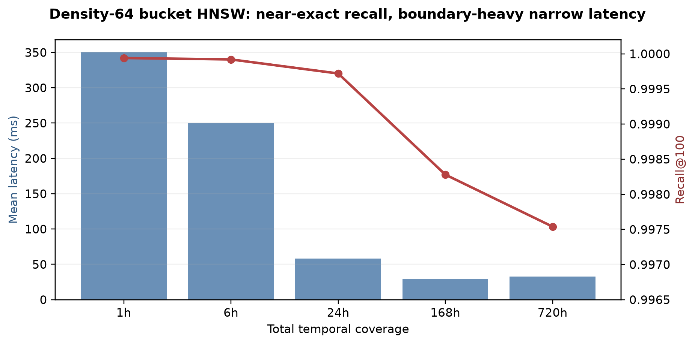
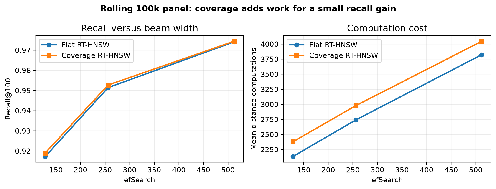
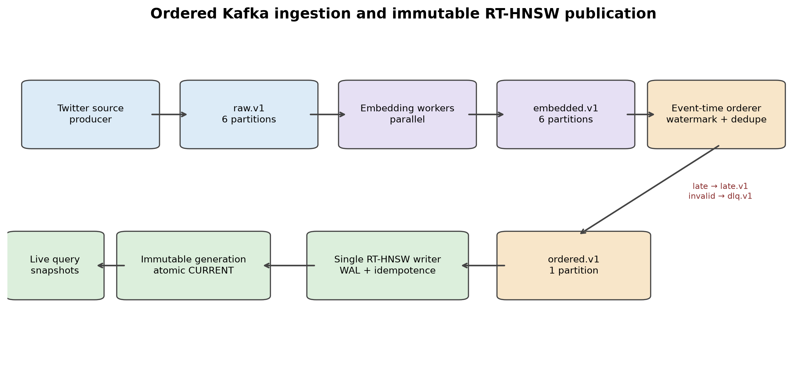
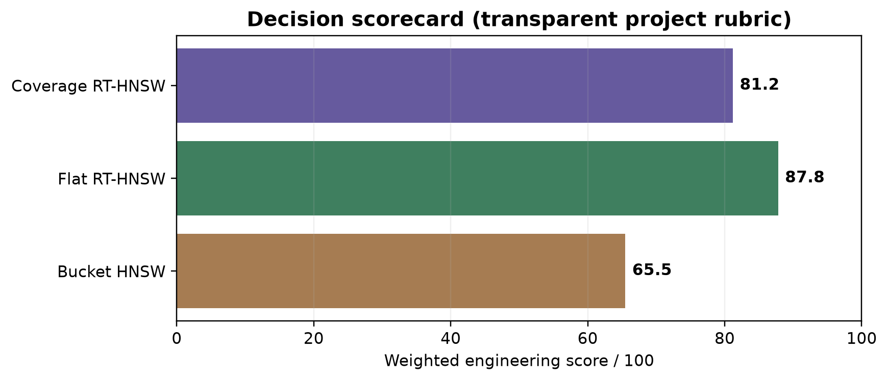

# Abstract

Approximate nearest-neighbor search (ANNS) is a core operation in contemporary
vector databases, but conventional graph indexes perform poorly when similarity
search is combined with selective metadata predicates. This project studies the
specific problem of retrieving the nearest vector representations of Twitter
records subject to one or more timestamp intervals. Three temporal-filtered
HNSW architectures are designed and evaluated: (i) density-balanced bucket
HNSW, which partitions the temporal domain and searches multiple conventional
indexes; (ii) flat multi-scale rolling temporal HNSW (RT-HNSW), which maintains
one chronologically constructed graph with protected temporal connectivity and
range-aware edges; and (iii) coverage-aware RT-HNSW, which adds conservative
block metadata and mandatory regional exploration.

The evaluation uses two explicitly separated panels. Density-balanced bucket
HNSW is evaluated on 990,000 vectors and 9,600 queries; flat and coverage-aware
RT-HNSW are compared on the earliest 100,000 vectors and 900 matched queries.
Bucket HNSW achieves 0.9991 Recall@100 but incurs 144.18 ms mean and 566.15 ms
p95 latency, with especially high cost for narrow and fragmented predicates.
Flat RT-HNSW achieves approximately 0.9515 Recall@100 at `efSearch=256`, using
2,742 mean distance computations, while preserving strict pre-distance
filtering and exact fallback for small eligible sets. Coverage-aware RT-HNSW
raises same-`efSearch` recall from 0.95143 to 0.95273 and guarantees exploration
of every intersecting temporal block, but increases distance computations by
8.65%. At matched computation, its recall falls to 0.94317. The evidence shows
that explicit block coverage corrects rare missed-region failures but is not a
more efficient default search policy.

The project further develops an ordered Kafka update architecture for RT-HNSW.
Parallel ingestion and embedding are followed by event-time watermark ordering,
a single canonical index sequence, idempotent micro-batch updates, write-ahead
logging, immutable generations, atomic publication, and live snapshot queries.
The final recommendation is a hybrid query planner: exact pre-filtering for
small eligible sets, bucket HNSW when near-exact broad-range quality dominates,
flat multi-scale RT-HNSW for a tunable single-graph trade-off, and selective
coverage only for diagnosed tail-risk queries.

**Keywords:** filtered ANNS, temporal predicates, HNSW, range filtering,
streaming index, Kafka, immutable snapshots.

# 1. Introduction

## 1.1 Background

Dense vector representations are now routinely used for semantic retrieval over
documents, images, products, social-media records, and retrieval-augmented
generation corpora. In operational systems, however, semantic similarity is
rarely the only constraint. Users may ask for records similar to a query while
restricting results by timestamp, price, location, or another ordered
attribute.

Hierarchical Navigable Small World graphs (HNSW) provide strong performance for
unfiltered ANNS, but an ordinary HNSW graph is organized by vector proximity,
not metadata eligibility. A query restricted to a narrow temporal interval may
retrieve globally similar vectors that are almost all invalid. Post-filtering
then produces low recall or fewer than the requested number of results.

Temporal range-filtered ANNS therefore presents a joint indexing problem:

1. the system must locate semantically relevant vectors;
2. it must enforce exact temporal eligibility; and
3. it should avoid spending most of its search budget on vectors that cannot be
   returned.

## 1.2 Problem statement

Let the database be

$$
D=\{(x_i,t_i,id_i)\}_{i=1}^{N},
$$

where $x_i\in\mathbb{R}^{d}$ is a vector, $t_i$ is a timestamp, and $id_i$ is a
stable record identifier. A query contains vector $q$, result count $k$, and a
set of temporal intervals

$$
P=\{[a_1,b_1),\ldots,[a_m,b_m)\}.
$$

The eligible set is

$$
D_P=\{(x_i,t_i,id_i)\in D:\exists [a_j,b_j)\in P,
\ a_j\le t_i<b_j\}.
$$

The exact objective is to return the $k$ vectors in $D_P$ minimizing squared
Euclidean distance

$$
d(q,x_i)=\sum_{r=1}^{d}(q_r-x_{ir})^2.
$$

An approximate method should maximize recall relative to this exact eligible
set while minimizing latency, distance computations, storage, update cost, and
operational complexity.

## 1.3 Research gap addressed by the project

Straightforward approaches expose a trade-off:

- global post-filtering preserves a mature HNSW but wastes candidates on
  ineligible vectors;
- pre-filtering followed by exact search is excellent for small eligible sets
  but expensive for broad ranges;
- temporal partitioning improves recall but creates boundary and multi-index
  fanout costs; and
- specialized range-aware graphs can integrate filtering into navigation but
  require custom construction, correctness invariants, and update mechanisms.

This project investigates whether a single rolling graph can provide a useful
middle ground between exact-like bucket quality and low-overhead global graph
search, and whether explicit temporal-region coverage improves that graph.

## 1.4 Research questions

The study is organized around four research questions.

**RQ1.** How does density-balanced temporal partitioning affect recall and
query cost across temporal widths and fragmented predicates?

**RQ2.** Can one chronologically constructed, multi-scale temporal graph enforce
strict filtering while providing a useful recall-computation trade-off?

**RQ3.** Does mandatory coverage of every intersecting temporal block improve
RT-HNSW robustly and efficiently?

**RQ4.** How can the recommended rolling graph be updated online without
violating chronological ordering or exposing partial index state?

## 1.5 Hypotheses

- **H1:** Bucket routing will provide near-exact recall, but partial boundary
  buckets and fragmented predicates will cause high and variable query cost.
- **H2:** Flat multi-scale RT-HNSW will provide lower recall than bucket HNSW but
  a more compact single-graph design with strict filtering and tunable search.
- **H3:** Mandatory block coverage will improve tail recall where ordinary beam
  search misses relevant temporal regions.
- **H4:** If missed-region failures are common, coverage-aware search will retain
  its advantage under an equal-computation comparison.
- **H5:** Event-time ordering, idempotent replay, and immutable generation
  publication can extend chronological RT-HNSW construction to a recoverable
  online pipeline.

The results support H1, H2, H3, and the architectural part of H5. H4 is
rejected: coverage does not retain an advantage at matched computation.

# 2. Research context

## 2.1 HNSW and filtered search

HNSW organizes vectors into a proximity graph with a sparse hierarchy. Upper
layers support long-range navigation, while a wider beam search at level zero
collects approximate nearest neighbors. Its performance depends on graph
connectivity and semantic entry points. Metadata filters can invalidate both:
an entry may be outside the predicate and semantic edges may lead primarily to
ineligible nodes.

Three generic filter strategies are relevant:

1. **Post-filtering:** run ordinary ANN globally, then reject invalid results.
2. **Pre-filtering:** identify eligible IDs first, then search or scan only them.
3. **Filter-aware indexing:** encode attribute structure in partitioning,
   topology, entry selection, or adjacency metadata.

This project focuses on the second and third strategies.

## 2.2 Related range-filtered graph research

Recent work demonstrates that ordered-attribute filtering requires more than a
fixed global overfetch factor.

- **SeRF** develops segment graphs for range-filtering ANNS and compresses the
  family of range-specific graph indexes [2].
- **Window Search / WinFilter** studies tree-based transformations for ANN under
  numeric windows [3].
- **iRangeGraph** constructs range-dedicated graph structures for
  range-filtering nearest-neighbor search [4].
- **Dynamic Segment Graph** studies dynamic range-filtering ANNS when data and
  queries arrive in a stream, highlighting the difference between arrival
  order and ordered attribute values [5].

The present project does not claim universal novelty over these systems. Its
contribution is an independently implemented and experimentally evaluated
combination centered on chronological Twitter ingestion, protected temporal
connectivity, independent multi-scale edge budgets, strict pre-distance
filtering, exact fallback, explicit coverage diagnostics, and Kafka-based
immutable publication.

## 2.3 Position of this project

Bucket HNSW represents temporal partitioning with mature per-partition ANN.
Flat RT-HNSW represents a single custom graph whose topology understands
co-eligibility. Coverage-aware RT-HNSW tests a stronger regional-participation
invariant. Together they form a controlled design progression:

```text
partition the data
        ↓
encode time in one graph
        ↓
require every temporal region to participate
        ↓
make construction durable and replayable
```

# 3. Contributions

The project makes the following technical and empirical contributions.

1. **A full-data bucket HNSW baseline** using density-balanced temporal
   partitions, exact boundary filtering, safe ID mapping, interval-union
   routing, deduplication, and exact global reranking.
2. **A flat multi-scale RT-HNSW design** combining semantic edges, a protected
   chronological backbone, independent 24-, 168-, and 720-hour range budgets,
   co-eligibility scoring, strict pre-distance filtering, and exact fallback.
3. **A coverage-aware extension** with conservative block bounds, diverse block
   representatives, mandatory block-local expansion, and separate ANN
   scheduling.
4. **A correctness-oriented test framework** verifying half-open boundaries,
   strict filtering, graph isolation, and that out-of-range vector rows are not
   scored.
5. **An equal-budget negative result:** mandatory coverage improves recall at
   equal `efSearch` but loses under matched distance computations.
6. **A durable online-update architecture** with Kafka event-time ordering,
   contiguous index sequences, write-ahead logging, idempotent replay,
   immutable generations, and live snapshot pinning.
7. **A transparent decision rubric** separating empirical metrics from
   engineering judgment and explicitly acknowledging non-comparable evaluation
   panels.

# 4. Experimental methodology

## 4.1 Data representation

The database consists of DLT-Tweets records represented by normalized
384-dimensional MiniLM embeddings. Every vector is associated with a timestamp
and stable source identifier. Squared L2 is used consistently by the exact
oracle and ANN implementations.

## 4.2 Two-panel experimental design

Not all methods were measured on one identical corpus. The analysis therefore
uses two panels and prohibits direct latency claims across them.

### Panel A: full Twitter bucket study

| Variable | Setting |
|---|---|
| Database size | 990,000 vectors |
| Query count | 9,600 |
| Dimension | 384 |
| $k$ | 100 |
| Coverage widths | 1, 6, 24, 168, 720 hours |
| Predicate components | 1, 2, 3, 4 |
| Traffic strata | Burst, ordinary, quiet |
| Ground truth | Exact eligible scan |

### Panel B: rolling graph study

| Variable | Setting |
|---|---|
| Database size | 100,000 earliest vectors |
| Query count | 900 |
| Dimension | 384 |
| $k$ | 100 |
| Coverage widths | 1, 6, 24, 168, 720 hours |
| Predicate components | 1, 2, 4 |
| Exact fallback | Eligible count $\le 5,000$ |
| Ground truth | Exact eligible scan |

Flat and coverage-aware RT-HNSW use the same graph, vectors, workload, and
oracle, enabling paired query-level analysis.

## 4.3 Independent variables

- Index architecture.
- Temporal coverage width.
- Predicate fragmentation.
- RT-HNSW `efSearch`.
- Coverage block size.
- Representatives scored per block.
- Mandatory expansions per block.

## 4.4 Dependent variables

- Recall@100 and precision@100.
- Complete-result rate.
- Mean, p50, and p95 latency.
- Distance computations and nodes visited.
- Semantic, range, temporal, and gateway edges examined.
- Candidate and partial-bucket counts.
- Ground-truth block coverage.
- Build time and persisted storage.

## 4.5 Correctness protocol

The exact oracle first performs authoritative timestamp filtering and then
computes squared L2 over every eligible vector. All predicates use half-open
semantics. Tests cover:

- duplicate timestamps at interval boundaries;
- disjoint interval unions;
- fewer-than-$k$ eligible records;
- deterministic chronological ordering;
- exact fallback equivalence;
- out-of-range destination rejection before distance calculation; and
- vector-row auditing to prove that strict graph traversal does not access
  ineligible vectors.

## 4.6 Statistical analysis

Flat and coverage-aware results are paired by workload ID. At `efSearch=256`,
the all-query mean recall difference is accompanied by a paired bootstrap 95%
interval. Per-query improve/tie/regress counts and lower-tail percentiles are
reported. Computation-matched configurations test whether improvements are due
to the mechanism or simply additional work.

## 4.7 Measurement caution

Bucket traversal executes in optimized FAISS code; custom RT-HNSW traversal is
primarily Python. Memory-map warming and execution order affect latency. Recall
and deterministic work counters are the principal evidence for small RT-HNSW
differences. A unified native implementation remains necessary for a definitive
systems comparison.

# 5. Method I: density-balanced bucket HNSW

## 5.1 Research rationale

Temporal partitioning restricts ANN search before graph traversal. Equal-width
time buckets are unsuitable for bursty social-media traffic because bucket
populations vary sharply. Density-balanced buckets seek approximately equal
vector counts while preserving equal-timestamp groups.

## 5.2 Construction

The evaluated configuration uses 64 buckets, HNSW `M=32`,
`efConstruction=200`, `efSearch=128`, overfetch 2, and boundary safety 1.25.
Construction proceeds as follows:

1. stably sort database IDs by timestamp;
2. derive density-balanced boundaries without splitting duplicate timestamps;
3. assign every vector to exactly one bucket;
4. build one FAISS `IndexHNSWFlat` per bucket;
5. persist local-to-global mappings and timestamp metadata; and
6. write a manifest containing boundaries and construction parameters.

## 5.3 Query algorithm

```text
normalize interval union
        ↓
route to intersecting buckets
        ↓
fully covered bucket: ordinary HNSW
partial bucket: overfetch + exact timestamp filter
        ↓
deduplicate global IDs
        ↓
exact rerank across all bucket candidates
```

For a fully covered bucket, every local vector is eligible. For a partial
boundary bucket, the planner estimates overlap selectivity and requests more
candidates. Multiple intervals are routed as a union so the same bucket is not
searched repeatedly.

```python
def bucket_query(q, intervals, k):
    routes = route(normalize_union(intervals))
    candidates = []
    for bucket, overlap in routes:
        budget = ordinary_budget(bucket) if overlap.full else \
                 boundary_budget(bucket, overlap)
        local = bucket.hnsw.search(q, budget)
        if not overlap.full:
            local = [v for v in local if eligible(v.timestamp, intervals)]
        candidates.extend(to_global_ids(local))
    return exact_rerank(unique(candidates), q, k)
```

## 5.4 Results

| Metric | Result |
|---|---:|
| Recall@100 | **0.99908** |
| Mean latency | 144.18 ms |
| p50 latency | 44.43 ms |
| p95 latency | 566.15 ms |
| Mean candidates examined | 18,708 |
| Mean valid candidates | 827.66 |
| Mean distance computations | 35,811 |
| Mean selected buckets | 3.89 |
| Mean partial buckets | 3.26 |
| Complete-result rate | 0.9329 |
| Build time | 52.67 s |
| HNSW storage | 1.790 GB |
| ID and timestamp metadata | 15.9 MB |

{width=90%}

### Coverage-width effect

| Width | Recall@100 | Mean latency | p95 latency | Computations |
|---:|---:|---:|---:|---:|
| 1 h | 0.99994 | 350.43 ms | 581.88 ms | 38,166 |
| 6 h | 0.99992 | 250.23 ms | 579.02 ms | 37,850 |
| 24 h | 0.99972 | 58.27 ms | 203.59 ms | 33,894 |
| 168 h | 0.99828 | 29.00 ms | 150.92 ms | 28,941 |
| 720 h | 0.99754 | 32.95 ms | 154.01 ms | 40,206 |

The result supports H1. Narrow predicates are not cheap because they often
occupy a small fraction of a large density-balanced bucket. Boundary overfetch
must retrieve many ineligible candidates to obtain up to 100 valid results.

### Fragmentation effect

| Components | Recall@100 | Mean latency | p95 latency | Computations |
|---:|---:|---:|---:|---:|
| 1 | 0.99831 | 42.58 ms | 146.67 ms | 16,168 |
| 2 | 0.99907 | 106.22 ms | 291.50 ms | 29,718 |
| 3 | 0.99939 | 176.29 ms | 437.99 ms | 42,674 |
| 4 | 0.99955 | 251.61 ms | 586.92 ms | 54,685 |

Recall remains nearly exact, but each additional interval can introduce two
partial boundaries and additional index searches.

## 5.5 Interpretation

Bucket HNSW is the quality-maximizing method in this study. It is suitable when
broad-range near-exact recall justifies high fanout and memory cost. It should
not be the sole query path: an exact eligible scan is preferable for sufficiently
small ranges.

# 6. Method II: flat multi-scale RT-HNSW

## 6.1 Research rationale

Flat RT-HNSW tests whether temporal eligibility can be integrated into a single
graph rather than represented by separate indexes. Vectors are inserted in
stable chronological order, making temporal intervals contiguous in local-ID
space.

## 6.2 Graph construction

The recommended topology uses:

| Edge class | Budget |
|---|---:|
| Semantic | 20 |
| 24-hour left/right | 2 + 2 |
| 168-hour left/right | 2 + 2 |
| 720-hour left/right | 2 + 2 |
| Nominal semantic plus range | 32 |
| Protected predecessor/successor | Separate |

FAISS HNSW is used only to generate semantic construction candidates among
previously inserted vectors. Every node receives protected predecessor and
successor links. Range candidates are drawn independently at each scale and
ranked by vector distance adjusted by temporal co-eligibility.

The independent scale budgets are important: otherwise broad-range links can
eject links useful to narrow or medium filters.

## 6.3 Query algorithm

1. Normalize intervals and use timestamp binary search to derive local-ID
   components.
2. Count eligible vectors.
3. If eligible count is at most 5,000, execute exact search.
4. Otherwise, select periodic in-range entry candidates.
5. Traverse semantic, temporal, and multi-scale edges with a beam.
6. Reject an out-of-component destination before reading its vector.
7. Search disjoint components independently.
8. Deduplicate and exactly rerank retained candidates.

```python
def strict_expand(current, component):
    for neighbor in all_enabled_edges(current):
        if neighbor < component.left or neighbor >= component.right:
            continue                    # strict pre-distance filtering
        if neighbor in visited:
            continue
        distance = squared_l2(query, vectors[neighbor])
        update_beam(neighbor, distance)
```

## 6.4 Results

| efSearch | Recall@100 | Mean latency | p95 latency | Computations |
|---:|---:|---:|---:|---:|
| 128 | 0.9173 | 4.65 ms | 18.02 ms | 2,134 |
| 256 | 0.9515 | 7.57 ms | 33.86 ms | 2,742 |
| 512 | 0.9741 | 12.96 ms | 61.82 ms | 3,825 |
| 1,024 | 0.9875 | 22.83 ms | 114.56 ms | 5,630 |
| 2,048 | 0.9946 | 41.44 ms | 211.75 ms | 8,352 |

| Construction metric | Result |
|---|---:|
| Build time | 133.1 s |
| Custom graph storage, vectors excluded | Approximately 15.6 MB |
| Periodic gateways | 195 |

### Broad queries

| Width | ef256 | ef512 | ef1024 | ef2048 |
|---:|---:|---:|---:|---:|
| 168 h | 0.8699 | 0.9316 | 0.9694 | 0.9872 |
| 720 h | 0.8873 | 0.9391 | 0.9681 | 0.9860 |

Narrow 1-, 6-, and 24-hour cells generally use exact fallback and reach recall
1.0. The approximate challenge is concentrated in broad ranges.

### Fragmentation at ef256

| Components | Recall@100 | Mean latency | Computations |
|---:|---:|---:|---:|
| 1 | 0.9416 | 4.40 ms | 1,563 |
| 2 | 0.9452 | 7.55 ms | 2,147 |
| 4 | 0.9675 | 10.76 ms | 4,516 |

Work increases approximately additively because each component receives an
independent search. The recall increase partly reflects additional independent
beam budgets.

## 6.5 Interpretation

The results support H2. Flat RT-HNSW establishes a continuous quality-cost
curve, strict temporal correctness, and compact custom adjacency. Its quality
at practical beam widths is lower than bucket HNSW, especially for broad
queries, but it avoids boundary overfetch and multi-index lifecycle complexity.
It is the strongest evaluated single-graph design.

# 7. Method III: coverage-aware RT-HNSW

## 7.1 Research rationale

A similarity-prioritized beam may concentrate on a few graph basins and leave
parts of a broad temporal predicate unexplored. Coverage-aware RT-HNSW tests
whether explicit temporal-region participation addresses this failure.

## 7.2 Metadata and invariants

The ordered graph is partitioned into fixed-population blocks. At block size
512, the 100,000-vector index has approximately 196 blocks. Each block stores
conservative min/max timestamps and up to four representatives:

- first temporal vector;
- last temporal vector;
- sampled approximate medoid; and
- sampled farthest-point vector.

The additional metadata is approximately 8 KB, excluding array headers.

For query component $Q$, let

$$
B_Q=\{B_i: interval(B_i)\cap Q\ne\emptyset\}.
$$

Search enforces

$$
\forall B_i\in B_Q,\quad expanded(B_i)\ge e,
$$

where $e$ is the mandatory expansion count. This guarantees block participation,
not examination of every eligible vector and not exact recall.

## 7.3 Query algorithm

```text
discover intersecting blocks
        ↓
score representatives in each block
        ↓
select a query-aware block seed
        ↓
mandatory block-local expansion
        ↓
merge block frontiers
        ↓
ordinary strict global RT-HNSW beam
```

Coverage termination is separate from ANN termination. Out-of-range vectors
remain forbidden; coverage does not use invalid nodes as routing bridges.

## 7.4 Main controlled result

| Metric | Flat ef256 | Coverage ef256 | Change |
|---|---:|---:|---:|
| Recall@100 | 0.95143 | 0.95273 | +0.00130 |
| Graph-query recall | 0.87511 | 0.87846 | +0.00334 |
| Distance computations | 2,741.9 | 2,979.0 | +8.65% |
| Nodes visited | 2,733.4 | 2,868.6 | +4.95% |
| Semantic edges examined | 3,914.0 | 4,623.9 | +18.14% |
| Range edges examined | 2,125.7 | 2,517.4 | +18.43% |
| Ground-truth block coverage | 99.924% | 100% | +0.076% |
| Coverage invariant failures | — | 0 |

The paired all-query recall gain has an approximate 95% bootstrap interval of
`[+0.00070,+0.00201]`.

{width=95%}

## 7.5 Equal-computation test

| Configuration | Computations | Recall@100 |
|---|---:|---:|
| Flat ef256 | 2,741.9 | **0.95143** |
| Coverage ef205, four representatives | 2,746.8 | 0.94317 |
| Coverage ef238, one representative | 2,747.9 | 0.94933 |

H4 is rejected. Same-`efSearch` coverage gains are produced by additional work,
not a superior allocation of a fixed computation budget.

## 7.6 Beam-width stability

| efSearch | Flat recall | Coverage recall | Gain | Flat computations | Coverage computations |
|---:|---:|---:|---:|---:|---:|
| 128 | 0.91726 | 0.91898 | +0.00172 | 2,134.5 | 2,379.1 |
| 256 | 0.95143 | 0.95273 | +0.00130 | 2,741.9 | 2,979.0 |
| 512 | 0.97410 | 0.97440 | +0.00030 | 3,823.8 | 4,046.1 |

The benefit approaches zero as the ordinary beam becomes stronger.

## 7.7 Query-level stability

At ef256, 75 of 900 queries improve, 801 tie, and 24 regress. Among 350
approximately searched queries:

| Statistic | Flat | Coverage |
|---|---:|---:|
| Mean recall | 0.87511 | 0.87846 |
| Standard deviation | 0.10545 | 0.10182 |
| 5th percentile | 0.6845 | 0.6900 |
| 10th percentile | 0.7400 | 0.7400 |
| Median | 0.9000 | 0.9000 |

Coverage slightly tightens the distribution but is not monotonically better.

## 7.8 Diagnostic explanation

Flat RT-HNSW already visits almost all blocks containing exact top-100 results:

- overall ground-truth block coverage: 99.924%;
- approximate-query block coverage: 99.805%; and
- queries missing any ground-truth block: 3 of 350.

Coverage improves all three exceptional cases:

| Workload | Width | Components | Flat recall | Coverage recall |
|---:|---:|---:|---:|---:|
| 81 | 168 h | 1 | 0.15 | 0.21 |
| 214 | 720 h | 4 | 0.58 | 0.63 |
| 664 | 720 h | 2 | 0.78 | 0.79 |

This supports H3 but explains the weak average effect: missed temporal regions
are rare; most errors occur within already visited regions.

## 7.9 Sensitivity analysis

### Block size

| Block size | Recall | Computations | Blocks considered |
|---:|---:|---:|---:|
| 256 | 0.95387 | 3,208.8 | 73.82 |
| 512 | 0.95273 | 2,979.0 | 37.28 |
| 1,000 | 0.95203 | 2,861.7 | 19.45 |
| 2,048 | 0.95172 | 2,800.0 | 9.88 |

### Representatives

| Representatives scored | Recall | Computations |
|---:|---:|---:|
| 1 | 0.95196 | 2,828.8 |
| 2 | 0.95249 | 2,877.4 |
| 4 | 0.95273 | 2,979.0 |

### Mandatory expansions

| Expansions per block | Recall | Computations |
|---:|---:|---:|
| 1 | 0.95273 | 2,979.0 |
| 2 | 0.95342 | 3,078.7 |
| 5 | 0.95553 | 3,369.9 |

Every stronger coverage setting increases work. The mechanism is best treated
as a diagnostic or conditional policy.

# 8. Comparative discussion

## 8.1 Architectural differences

| Property | Bucket HNSW | Flat RT-HNSW | Coverage RT-HNSW |
|---|---|---|---|
| Logical graphs | 64 | 1 | 1 |
| Temporal routing | Bucket directory | In-range entries | Block directory + entries |
| Time encoded in topology | Partition ownership | Backbone and range edges | Same flat topology |
| Strict pre-distance filter | Partial buckets | Yes | Yes |
| Exact fallback | Planner-dependent | Yes | Yes |
| Explicit region guarantee | Bucket routing | No | Yes |
| Main strength | Near-exact recall | Single-graph trade-off | Deterministic coverage |
| Main weakness | Boundary/fanout cost | Broad-range recall | Mandatory overhead |

## 8.2 Evidence by research question

### RQ1: effect of temporal partitioning

Density-balanced bucket HNSW provides near-exact recall across every width and
fragmentation level. Its cost is highly nonuniform: 1-hour queries average
350.43 ms, while 168-hour queries average 29.00 ms. Fragmentation increases mean
latency from 42.58 ms for one component to 251.61 ms for four. H1 is supported.

### RQ2: viability of one temporal graph

Flat RT-HNSW provides strict correctness, exact fallback, compact custom graph
storage, and a smooth recall-computation curve. At ef256 it reaches about 0.9515
overall recall, rising to 0.9946 at ef2048. H2 is supported, although broad
query quality remains below the bucket result.

### RQ3: value of mandatory coverage

Coverage corrects rare region-miss failures and reaches 100% ground-truth block
coverage, but loses at equal computation. H3 is supported only for tail cases;
H4 is rejected.

### RQ4: online update feasibility

A correctness-first Kafka architecture and durable writer have been implemented
and differentially tested without broker-level failure injection. Chronological
ordering and immutable publication are feasible, but production validation and
chunked persistence remain. H5 is partially supported.

## 8.3 Quantitative panels

### Panel A: bucket HNSW, 990k vectors

| Recall | Mean latency | p95 | Computations | Build time |
|---:|---:|---:|---:|---:|
| 0.99908 | 144.18 ms | 566.15 ms | 35,811 | 52.67 s |

### Panel B: controlled RT-HNSW comparison, 100k vectors

| Method | Recall | Computations | GT block coverage |
|---|---:|---:|---:|
| Flat ef256 | 0.95143 | 2,741.9 | 0.99924 |
| Coverage ef256 | 0.95273 | 2,979.0 | 1.00000 |
| Coverage matched-compute | 0.94317 | 2,746.8 | 1.00000 |

These tables must remain separate until all architectures are rerun on one
identical panel.

# 9. Streaming extension: ordered Kafka updates

## 9.1 Systems objective

Chronological offline construction is algorithmically incremental but does not
by itself provide live ingestion, crash recovery, consumer checkpoints, or
snapshot isolation. The streaming extension preserves the invariant

$$
local\_id\ order = nondecreasing\ event\ time
$$

while allowing parallel source and embedding stages.

{width=96%}

## 9.2 Data flow

```text
Twitter source
    ↓
raw topic, six partitions
    ↓
validation and parallel embedding
    ↓
embedded topic, six partitions
    ↓
event-time orderer, watermark, deduplication
    ↓
canonical ordered topic, one partition
    ↓
single durable RT-HNSW writer
    ↓
immutable generation + atomic CURRENT
    ↓
live snapshot query service
```

Late events go to a late topic; invalid or conflicting records go to a dead
letter topic.

## 9.3 Topic design

| Topic | Partitions | Retention | Function |
|---|---:|---|---|
| `twitter.raw.v1` | 6 | 7 days | Source envelope |
| `twitter.embedded.v1` | 6 | 7 days | Parallel embedding output |
| `twitter.index.ordered.v1` | 1 | Indefinite | Canonical replay log |
| `twitter.index.late.v1` | 3 | 30 days | Behind-watermark events |
| `twitter.index.dlq.v1` | 3 | 30 days | Invalid/conflicting events |
| `twitter.orderer.state.v1` | 1 | Compacted | Watermark and dedupe state |
| `twitter.index.checkpoints.v1` | 1 | Compacted | Published generation state |

## 9.4 Event-time ordering

Kafka ordering is partition-local and follows arrival order, not event time.
For each active embedded partition $p$, the orderer tracks maximum event time
$M_p$. With allowed lateness $L$, the global watermark is

$$
W=\min_p M_p-L.
$$

Buffered records with ordering keys at or below $W$ are emitted in deterministic
order. Idle partitions are excluded after a timeout to prevent watermark
stalling. The canonical ordered topic has one partition and contiguous
`index_sequence` values.

For historical replay to match the offline graph exactly, Kafka and offline
construction must use the same tie key. A finite replay additionally needs an
explicit end-of-stream watermark or flush event.

## 9.5 Durable micro-batch protocol

For every contiguous batch:

1. poll without committing Kafka offsets;
2. validate sequence, order, vector dimension, finite values, model, and hash;
3. write and `fsync` an append WAL;
4. apply semantic, temporal, range, reciprocal, and gateway updates;
5. persist FAISS construction-candidate state;
6. write a checksummed generation in a staging directory;
7. atomically replace `CURRENT`;
8. publish the checkpoint;
9. commit the Kafka offset; and
10. retire obsolete WAL records.

A redelivered published batch is skipped only if sequence and content hash
match. A conflict is rejected rather than overwritten.

## 9.6 Snapshot consistency

Readers resolve `CURRENT`, pin one immutable generation, and retain it for the
query duration. Publication uses read-copy-update semantics: existing queries
finish on generation $N$, while new queries open $N+1$. Reader leases prevent
premature generation deletion. Responses expose generation and sequence so a
client can enforce minimum freshness.

## 9.7 Late data

An event older than the committed watermark cannot be appended without breaking
ordered local IDs. The initial policy quarantines it rather than silently
corrupting the graph. Future policies include scheduled rebuild, a query-merged
late delta index, or bounded repair inside an unsealed recent segment.

## 9.8 Implementation status

Implemented and unit/differential tested:

- validated producer and development embedder;
- transactional watermark orderer;
- duplicate, conflict, late, and DLQ handling;
- contiguous sequence allocation;
- compacted state changelog;
- durable flat multi-scale writer;
- persisted FAISS construction state;
- WAL and orphan recovery;
- immutable checksummed generations;
- atomic publication and idempotent replay;
- live snapshot reload and query pinning; and
- freshness waits and reader leases.

Outstanding:

- broker-level process-kill and transaction-abort tests;
- production embeddings and Schema Registry;
- append-only chunks or copy-on-write adjacency pages;
- automatic generation retention and compaction;
- late-event delta support;
- authentication and rate limiting; and
- scaling to 250k, 500k, and 990k vectors.

The prior broker integration run was blocked by an unavailable Docker daemon;
unit and differential tests cannot substitute for real broker failure tests.

## 9.9 Development commands

```bash
docker compose -f deploy/kafka/docker-compose.yml up -d
./deploy/kafka/create-topics.sh
pip install -e '.[kafka]'

kafka-twitter-embedder --index-name twitter-rt-hnsw
kafka-twitter-orderer --index-name twitter-rt-hnsw \
  --allowed-lateness-ms 600000
kafka-twitter-index-writer \
  --index-name twitter-rt-hnsw \
  --index Twitter_data/ann/streaming_rt_hnsw
serve-twitter-rt-hnsw \
  --index Twitter_data/ann/streaming_rt_hnsw --port 8080
kafka-twitter-producer --input new_tweets.jsonl
```

# 10. Novelty and research significance

## 10.1 Bounded novelty statement

The project does not claim to originate filtered graph ANNS, segment graphs, or
window-filter trees. Its novelty lies in the implemented combination and the
empirical decisions it supports.

### Flat RT-HNSW contribution

- protected chronological links that semantic pruning cannot remove;
- independent range-edge budgets at workload-relevant time scales;
- temporal co-eligibility in edge selection;
- strict pre-distance filtering;
- hybrid exact/approximate execution; and
- chronological construction compatible with ordered event streams.

### Coverage-aware contribution

- conservative population-block metadata;
- temporal-boundary and semantic-diversity representatives;
- a mandatory queue independent of ANN termination;
- formal block-coverage diagnostics; and
- a negative equal-budget result showing that stronger coverage is not
  automatically a better ANN policy.

### Streaming contribution

- separation of parallel ingestion from a canonical ordered index log;
- deterministic contiguous sequence assignment;
- idempotent graph updates across the Kafka/filesystem boundary;
- immutable generation publication; and
- generation-pinned live queries.

## 10.2 Significance of the negative result

The coverage experiment is scientifically useful despite not replacing the
baseline. It distinguishes two failure modes:

1. **missed-region failure**, where traversal never reaches a block containing a
   true neighbor; and
2. **within-region failure**, where the relevant block is visited but graph
   exploration misses the vector.

Only 3 of 350 approximate queries exhibit the first failure. The dominant
research direction should therefore improve semantic navigation inside visited
regions, not mandate broader temporal coverage.

# 11. Threats to validity

## 11.1 Internal validity

- Python traversal and memory-map cache state affect latency.
- Variant order can make a later run appear faster after warming pages.
- `efSearch` is a heap-capacity parameter, not a strict computation budget;
  equal-computation runs are therefore required.
- FAISS thread count and library version can affect construction determinism.

Mitigation: conclusions emphasize recall and deterministic counters, and the
coverage decision uses matched computations.

## 11.2 Construct validity

Overall RT-HNSW recall mixes exact narrow queries with approximate broad
queries. Reporting only overall recall can conceal broad-range weaknesses.

Mitigation: 168- and 720-hour results are reported separately, alongside exact
fallback behavior.

## 11.3 External validity

- RT-HNSW is evaluated only on the earliest 100,000 Twitter vectors.
- One embedding model, dimension, metric, and timestamp distribution are used.
- Ordered Twitter arrivals are favorable to chronological construction.
- Other attributes, datasets, and arbitrary-order updates may behave
  differently.

## 11.4 Comparative validity

Bucket and RT-HNSW results use different database sizes and workloads. Direct
latency or storage rankings across these panels would be misleading.

Mitigation: panel separation is maintained throughout the report. A unified
990k experiment is identified as required future work.

## 11.5 Systems validity

The Kafka architecture has strong unit and differential evidence, but broker-
level failure injection was not completed. Full-generation rewrites are also
not production-scalable.

# 12. Project assessment rubric

The following self-assessment is included to make project scoring transparent.
It is not an external grade.

| Assessment dimension | Weight | Score | Weighted contribution | Evidence |
|---|---:|---:|---:|---|
| Problem formulation and research questions | 15 | 14 | 14.0 | Formal RFANNS objective, hypotheses, two-panel design |
| Technical design depth | 20 | 18 | 18.0 | Three architectures, strict traversal, streaming writer |
| Experimental rigor | 20 | 17 | 17.0 | Exact oracle, 9,600/900-query panels, paired and equal-budget tests |
| Correctness and validation | 15 | 14 | 14.0 | Half-open tests, row-access audit, differential replay tests |
| Novelty and critical analysis | 15 | 13 | 13.0 | Multi-scale topology, coverage invariant, negative result |
| Reproducibility and documentation | 10 | 9 | 9.0 | Commands, manifests, summaries, design documents |
| Production readiness | 5 | 3 | 3.0 | Durable design implemented; broker and chunked-storage work pending |
| **Total** | **100** | — | **88/100** | Strong research prototype with explicit remaining limitations |

{width=80%}

The lower production-readiness score prevents the project report from treating
the prototype as a finished production system.

# 13. Conclusions and recommendations

This project demonstrates that temporal-filtered vector search cannot be
reduced to one universally optimal HNSW configuration.

1. Density-balanced bucket HNSW achieves near-exact quality but exhibits high
   boundary and fragmentation cost.
2. Flat multi-scale RT-HNSW provides the strongest current single-graph design,
   with strict correctness, compact adjacency, exact fallback, and tunable
   quality.
3. Coverage-aware RT-HNSW provides a valid and useful regional-participation
   invariant, but does not improve equal-budget quality and should not replace
   flat RT-HNSW.
4. Ordered Kafka ingestion and immutable publication provide a credible path
   from static chronological construction to a recoverable online index.

The recommended project architecture is:

> **Flat multi-scale RT-HNSW with strict filtering and exact fallback, updated
> through a single canonical Kafka event-time sequence and published as
> immutable query snapshots. Use bucket HNSW as the high-recall broad-range
> path and invoke coverage only when diagnostics predict a temporal-region
> miss.**

# 14. Future work

1. Run all architectures on the same 990,000-vector panel.
2. Implement strict traversal in fused C++/pybind11.
3. Scale RT-HNSW to 250k, 500k, and 990k vectors.
4. Replace full generations with append-only chunks or copy-on-write pages.
5. Run broker-level kill, transaction-abort, and replay-equivalence tests.
6. Add a late-arrival delta index and query-time merge.
7. Evaluate rolling expiration and temporal compaction.
8. Develop a selective coverage predictor and compare it under equal budgets.
9. Measure construction and query behavior on additional ordered attributes and
   datasets.
10. Standardize storage accounting across vectors, graph, mappings,
    construction state, WAL, and retained generations.

# References

[1] Y. A. Malkov and D. A. Yashunin. “Efficient and Robust Approximate Nearest
Neighbor Search Using Hierarchical Navigable Small World Graphs.” *IEEE
Transactions on Pattern Analysis and Machine Intelligence*, 42(4), 824–836,
2020.

[2] C. Zuo, M. Qiao, W. Zhou, F. Li, and D. Deng. “SeRF: Segment Graph for
Range-Filtering Approximate Nearest Neighbor Search.” *Proceedings of the ACM on
Management of Data*, 2(1), Article 69, 2024. DOI: 10.1145/3639324.

[3] J. Engels, B. Landrum, S. Yu, L. Dhulipala, and J. Shun. “Approximate
Nearest Neighbor Search with Window Filters.” arXiv:2402.00943, 2024.

[4] Y. Xu, J. Gao, Y. Gou, C. Long, and C. S. Jensen. “iRangeGraph: Improvising
Range-Dedicated Graphs for Range-Filtering Nearest Neighbor Search.”
*Proceedings of the ACM on Management of Data*, 2024. DOI: 10.1145/3698814.

[5] Z. Peng, M. Qiao, W. Zhou, F. Li, and D. Deng. “Dynamic Range-Filtering
Approximate Nearest Neighbor Search.” *Proceedings of the VLDB Endowment*,
18(10), 3256–3268, 2025. DOI: 10.14778/3748191.3748193.

# Appendix A. Reproducibility

## A.1 Build flat RT-HNSW

```bash
build-twitter-rt-hnsw \
  --output Twitter_data/ann/rolling_hnsw/flat_100k_multiscale \
  --vector-count 100000 \
  --semantic-degree 20 \
  --range-degree-per-side 2 \
  --range-scales-hours 24,168,720 \
  --ef-construction 200
```

## A.2 Compare flat and coverage-aware search

```bash
benchmark-twitter-rt-hnsw \
  --index Twitter_data/ann/rolling_hnsw/flat_100k_multiscale \
  --vectors Twitter_data/processed/database_vectors.npy \
  --queries Twitter_data/processed/query_vectors.npy \
  --workload Twitter_data/workloads/rt_hnsw_100k_queries.jsonl \
  --ground-truth results/twitter_rt_hnsw_100k/ground_truth.npz \
  --variants semantic_temporal_range,coverage_multiscale \
  --ef-search 256 \
  --exact-threshold 5000 \
  --coverage-expansions-per-block 1 \
  --coverage-gateway-candidates 4 \
  --output results/twitter_rt_hnsw_100k/coverage_ef256
```

## A.3 Run tests

```bash
PYTHONPATH=src .venv/bin/python -m unittest discover -s tests -v
```

# Appendix B. Evidence and implementation artifacts

| Artifact | Location |
|---|---|
| Full bucket summary | `results/twitter_bucket_hnsw_density_final/summary.json` |
| Flat/coverage summary | `results/twitter_rt_hnsw_100k/coverage_ef256/summary.json` |
| Coverage analysis | `results/twitter_rt_hnsw_100k/COVERAGE_AWARE_ANALYSIS.md` |
| Coverage design | `docs/COVERAGE_AWARE_RT_HNSW.md` |
| Multi-scale analysis | `results/twitter_rt_hnsw_100k/MULTISCALE_RANGE_ANALYSIS.md` |
| Gateway oracle | `results/twitter_rt_hnsw_100k/GATEWAY_ORACLE_ANALYSIS.md` |
| Kafka architecture | `docs/KAFKA_INCREMENTAL_RT_HNSW_ARCHITECTURE.md` on Kafka branch |
| Kafka schemas | `schemas/kafka/` on Kafka branch |
| Kafka deployment | `deploy/kafka/` on Kafka branch |

# Appendix C. Branch and test status

Research report branch:

```text
RT-HNSW-coverage-aware
```

Relevant commits before this report:

```text
b73582b  Add coverage-aware temporal block search
69d9904  Evaluate coverage-aware RT-HNSW
bd595ab  Add final three-architecture evaluation report
```

Coverage branch validation status:

```text
47 unit tests passing
0 block-coverage invariant failures in full sweeps
strict row-access auditing confirms no out-of-range vector is scored
```
